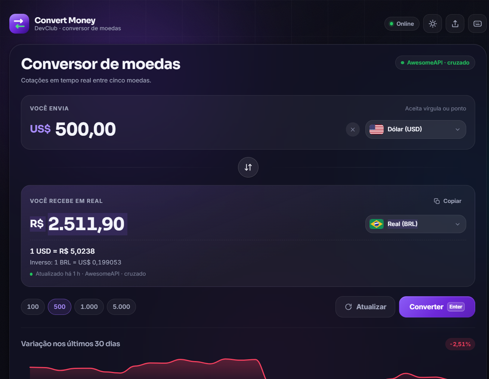

# Convert Money · DevClub

Conversor de moedas **profissional** feito com HTML, CSS e JavaScript puro — sem frameworks, sem dependências e sem etapa de build. Cotações em tempo real, série histórica, histórico local e uma interface que funciona do celular ao desktop.

**[🌐 Demo ao vivo](https://dantelemes0-rgb.github.io/Conversor-de-Moedas/)** · **[📦 Código no GitHub](https://github.com/dantelemes0-rgb/Conversor-de-Moedas)**

<p align="center">
  
</p>

---

## ✨ O que o projeto entrega

| Recurso | Detalhes |
| --- | --- |
| **Conversão entre 5 moedas** | Real (BRL), Dólar (USD), Euro (EUR), Libra (GBP) e Bitcoin (BTC), em qualquer direção |
| **Cotações em tempo real** | AwesomeAPI como fonte principal, com `exchangerate-api` e valores de contingência locais |
| **Zero tela em branco** | Pipeline de fallback + cache local: se a rede cair, a interface continua respondendo |
| **Cache inteligente** | Pinta na hora com o cache e revalida em segundo plano (*stale-while-revalidate*) |
| **Série de 30 dias** | Sparkline SVG desenhada à mão, com mínimo, máximo, média e variação do período |
| **Painel “Mercado agora”** | Quatro pares contra o real, com variação do dia; um clique carrega o par no conversor |
| **Histórico local** | Últimas 12 conversões salvas no navegador, com reuso e remoção individual |
| **Tema claro e escuro** | Respeita `prefers-color-scheme`, com alternância manual persistida e sem *flash* de tema |
| **Atalhos de teclado** | `Enter`, `S`, `C`, `/`, `R`, `T`, `?` e `Esc` — com modal de ajuda |
| **URL compartilhável** | O estado vive em `?de=USD&para=BRL&valor=1000`, pronto para compartilhar |
| **Acessibilidade** | Estrutura semântica, combobox ARIA, foco visível, `aria-live`, contraste AA e suporte a `prefers-reduced-motion` |
| **Responsivo de verdade** | Testado de 320 px a 1440 px+, sem rolagem horizontal em nenhum ponto |

---

## 🧠 Decisões de engenharia

- **CSS puro com tokens de design.** Todas as cores, espaços, raios, sombras e tempos ficam em custom properties: trocar de tema é trocar um atributo.
- **JavaScript em um único arquivo, organizado em 10 seções numeradas.** Sem `type="module"`, para funcionar também abrindo o `index.html` direto pelo disco (`file://`).
- **Formatação com `Intl`.** Máscara pt-BR, `tabular-nums` para os números não “dançarem” e precisão adaptativa para cotações (4 casas quando faz sentido, 8 para BTC).
- **Máscara de valor com preservação de foco.** Digite `1234,56` e o campo organiza sozinho em `1.234,56` ao sair, aceitando vírgula ou ponto na entrada.
- **Animação de contagem.** O resultado é animado com `requestAnimationFrame`, cancelado a cada nova digitação e desligado para quem pede menos movimento.
- **Dados de mercado com cache por TTL.** 10 minutos para cotações, 6 horas para a série histórica e validação de frescor em cada leitura.

---

## ▶️ Como executar

**Opção 1 — online:** acesse a [demo no GitHub Pages](https://dantelemes0-rgb.github.io/Conversor-de-Moedas/).

**Opção 2 — direto no navegador:** abra o arquivo `index.html`.

**Opção 3 — servidor local (recomendado para testar cache e PWA):**

```bash
# Python
python -m http.server 5173

# ou Node
npx serve -l 5173
```

Depois acesse `http://127.0.0.1:5173`.

---

## 🗂️ Estrutura

```
.
├── index.html                 Interface semântica e acessível
├── style.css                  Sistema de design (tokens, temas, componentes, responsivo)
├── scripts.js                 Estado, cotações, combobox, histórico e atalhos
├── manifest.webmanifest       Metadados para instalação como app
├── conversor-moedas-linkedin.png  Imagem de apresentação (Open Graph/Twitter)
├── assets/
│   ├── logo-mark.svg          Marca do app (favicon)
│   ├── icon-300.png           Ícone de instalação (PWA e Apple touch icon)
│   └── flags/                 Bandeiras e moeda em SVG: br, us, eu, gb, btc
└── README.md
```

---

## 🔗 Parâmetros de URL

| Parâmetro | Exemplo | Descrição |
| --- | --- | --- |
| `de` | `?de=USD` | Moeda de origem (BRL, USD, EUR, GBP ou BTC) |
| `para` | `?para=BRL` | Moeda de destino |
| `valor` | `?valor=1000,50` | Valor a converter |

Exemplo completo: `index.html?de=EUR&para=BRL&valor=250`

---

## ⌨️ Atalhos

| Tecla | Ação |
| --- | --- |
| `Enter` | Converter o valor informado |
| `S` | Inverter moedas de origem e destino |
| `C` | Copiar o resultado |
| `/` | Buscar uma moeda |
| `R` | Buscar cotações novamente |
| `T` | Alternar tema claro/escuro |
| `?` | Mostrar a lista de atalhos |
| `Esc` | Fechar listas e diálogos |

---

## 📊 Fonte dos dados

1. **[AwesomeAPI](https://economia.awesomeapi.com.br)** — cotações do par selecionado, painel de mercado e série diária (contingência do dia). Pares que a API não publica (ex.: `BRL-BTC`, `BTC-GBP`) são resolvidos invertendo o par ou calculando o cruzamento via real e aparecem como `AwesomeAPI · cruzado`.
2. **[exchangerate-api](https://www.exchangerate-api.com)** — usada quando a AwesomeAPI não responde; as taxas cruzadas são calculadas com base no real.
3. **Tabela local** — último recurso embutido no código, sinalizado na interface como `valores locais`.

> ⚠️ Os números são **informativos** e podem ter atraso em relação ao mercado. Este projeto não é recomendação de investimento.

---

## ♿ Acessibilidade

- Combobox no padrão ARIA 1.2 com `aria-expanded`, `aria-activedescendant` e navegação por setas, `Home`, `End`, `Esc` e digitação.
- Regiões `aria-live` para anunciar conversões e mensagens sem roubar o foco.
- Alvos de toque de no mínimo 40 px, anel de foco em `:focus-visible` e suporte a `forced-colors`.
- Contraste conferido nos dois temas, tipografia com `tabular-nums` e respeito a `prefers-reduced-motion`.

---

## 🧪 Qualidade verificada

- Sem erros no console durante navegação, digitação, troca de moedas e uso do histórico.
- Sem rolagem horizontal em 320, 390, 560, 768, 1024, 1180 e 1440 px.
- Cotações validando parse, formatação, inversão de par e estados de erro (`valor inválido`, `muito alto`, `negativo`).
- Histórico persistido e restaurável entre sessões.

---

## 📄 Licença

Projeto de estudo criado no **DevClub**. Uso livre para aprendizado e portfólio.
